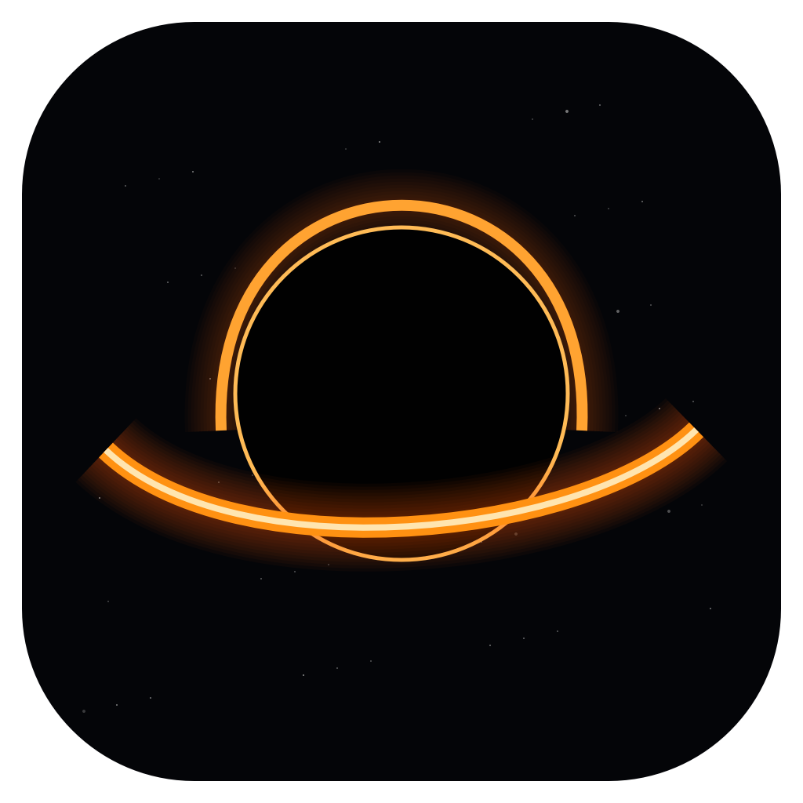
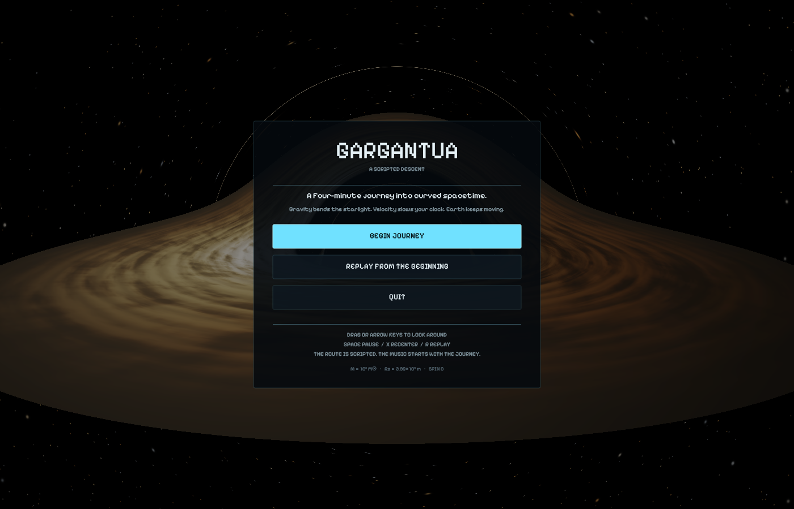
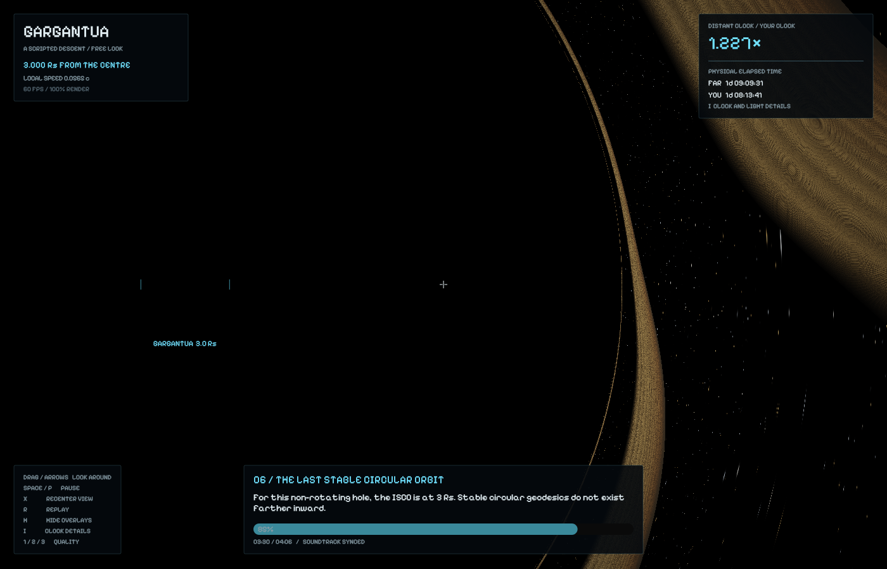

# Gargantua

### A Scripted Descent

A **4:06 interactive film**: a deterministic spiral from 500 Schwarzschild
radii toward a non-rotating black hole. There is no rocket, engine, or movement
control. You can look anywhere while the camera follows the authored route.
The sky, disk and lensing are rendered live with Schwarzschild null geodesics.

## Install

Download the latest packages from [GitHub Releases](https://github.com/nareshkarthigeyan/Gargantua/releases/latest).

- **macOS:** open the DMG and drag Gargantua onto Applications.
- **Windows 10/11 x64:** run the setup EXE, or extract the portable ZIP and open Gargantua.exe.

These are compiled, self-contained apps. You do **not** need Rust or development
libraries. A working GPU driver is required. Builds are not commercially signed
or Apple notarized; see the release notes for OS approval prompts. The personal
soundtrack is excluded. SHA-256 checksums accompany each release.

## Build from source

Install the [Rust toolchain](https://www.rust-lang.org/tools/install), then:

    git clone https://github.com/nareshkarthigeyan/Gargantua.git
    cd Gargantua
    cargo run --release

The project needs a GPU with a working wgpu backend. macOS on Apple Silicon is
the tested platform. The renderer uses cross-platform wgpu/winit, but Linux and
Windows packages are built and installer/launch/uninstaller smoke-tested in GitHub
Actions; interactive Windows graphics are not yet visually validated. The first build compiles the graphics
dependencies and can take a few minutes.

### Optional local soundtrack

The public repository **does not include the personal-use recording**. The
journey runs silently without it, using exactly the same timing. To enable
macOS audio, place a recording you are permitted to use at:

    assets/music/soundtrack.m4a

The authored timing expects a track about 4:06 long, with its final swell around
3:50. Details are in [the audio notes](assets/music/README.md). Local recordings
are ignored by Git. Native audio playback is currently macOS-only.

Click **BEGIN JOURNEY**. If a local soundtrack is installed, it starts with the film, never on the menu.
The first complete revolution finishes at 1:05. The spiral tightens through
nine fact stages, reaching the near-horizon climax at **3:50**, aligned to the
strongest late seven-second energy window of the supplied recording. The
remaining sixteen seconds hold the final scene while the music finishes.
The music does not loop.

| Control | Action |
| --- | --- |
| Move mouse or trackpad | Look around, full horizontal rotation |
| Arrow keys | Look around |
| X | Recenter on the cinematic framing |
| Space / P | Pause/resume film and soundtrack together |
| R | Replay film and music from the beginning |
| Esc | Pause menu |
| H | Immersive mode (alias) |
| I | Toggle immersive mode; hide all text and clocks |
| 1 / 2 / 3 | Set render-quality ceiling |

W/S/A/D, boost, roll and braking do not affect movement. Free look does not
spring back. You can continue looking around the frozen final scene.

## Choreography and facts

| Time | Stage |
| --- | --- |
| 0:00 | A distant observer; nearly matching clocks |
| 0:35 | The shadow and the first revolution |
| 1:10 | Light curves around the far side of the disk |
| 1:52 | Doppler shift and beaming |
| 2:33 | Gravity, motion, and the two clocks |
| 3:16 | Approaching the ISCO, the last stable circular orbit at 3 Rs |
| 3:38 | Approaching the photon sphere at 1.5 Rs |
| 3:46 | The event horizon at 1 Rs |
| 3:50 | The final signal; authored freeze at 1.0001 Rs |

Facts appear in full in a pixel-font dialogue box for two seconds per stage,
then the box and hints disappear. Its only hints are
I · Immersive on the left and Esc · Menu on the right. Two elapsed clocks,
Earth time and Your time, sit at the top right. Immersive mode hides everything.
The default camera gradually frames the rim; mouse look remains independent.

The soundtrack transport drives the route directly. Pausing suspends audio and
the timeline; replay resets both. No dragging is needed to look around.

## Physics and rendering

Units are G=c=1, Rs=1, M=0.5. The hole has mass 10^6 solar masses, giving
Rs/c about 9.85 seconds. The trajectory is **authored, not a freefall geodesic**.
Its local velocity is derived from the path derivative. Playback advances
24 geometric proper-time units per real second. The distant clock is derived
from Schwarzschild 4-velocity normalization, including gravity and motion.
A preintegrated fixed-step clock table makes results independent of frame rate.
Both clocks display elapsed simulated time, not wall-clock dates.

Each background pixel launches a ray in the observer's comoving frame, applies
aberration, and integrates a Schwarzschild null geodesic using RK4 with conserved
angular momentum and bounded radial/angular steps. Disk emission is sampled at
retarded emission time, accounting for accumulated coordinate light delay.
The opaque thin disk spans 3–12 Rs. Orbital Doppler shift and gravitational shift
come from photon constants of motion and emitter/observer 4-velocities.

The final freeze is cinematic. **A falling observer's own time does not stop at
the event horizon.** The optical view holds at a float32 cutoff of 1.0001 Rs. The double-precision
clock trajectory approaches a gap of about 1e-15 Rs, reaching roughly one Earth
year per local second. Clocks continue at that finite final ratio. Infinite
clock separation is a horizon limit, not a finite reading outside it. Holding
stationary this close requires thrust; this is an authored path, not free fall.

This is Schwarzschild, not Kerr: there is no spin or frame dragging. The thin
disk texture, thermal palette, small-star highlight compression, twinkling,
bloom and exposure compensation are display/art choices, not a complete
radiative-transfer model. Finite ray budgets limit extremely high-order photon images.

Reference: [Riazuelo, Seeing relativity I](https://arxiv.org/abs/1511.06025).

## Performance and validation

The default uses a 70% scene render scale and a 768-step maximum ray budget.
Most rays exit earlier. Quality ceilings are 50%/640, 70%/768 and 100%/1024.
The app adjusts resolution between 45% and the chosen ceiling when frame time
changes. Clock and audio timing remain unchanged. There is no spacecraft mesh,
exhaust, crosshair, or world-space text.

    cargo test --offline
    cargo run --release -- --validate-optics
    cargo run --release -- --benchmark --at 180 --width 1400 --height 900
    cargo run --release -- --screenshot shots/isco.png --at 210
    cargo run --release -- --screenshot shots/finale.png --at 230

The Rust tests check route monotonicity, a complete revolution, timelike
velocities, physical clock normalization, deterministic results across frame
rates, pause behavior, soundtrack transport, and independent free look. The
actual GPU integrator passes eleven analytic/reference optics checks, with
reference deflection errors below 2e-6 radians. Benchmarks measure the GPU scene
without window presentation or UI; they are not a full-app FPS guarantee.

Stills support --at SECONDS, --width, --height, --menu and --no-hud. Legacy
--frames, --orbit, --horizon and --dive select times on the same scripted route.
Headless captures never start the soundtrack.

## Assets

HUD text uses Pixelify Sans, licensed under the SIL Open Font License included
in assets/fonts/OFL.txt.

On macOS, the owned system audio player plays an optional local soundtrack once
at 55% player volume. Normal shutdown stops it. Other platforms currently use
the same transport timeline without audio. No music recording is distributed
with this repository.

## Project layout

| File | Purpose |
| --- | --- |
| src/journey.rs | Deterministic spiral, timeline, facts, and physical clock integration |
| src/app.rs | Native window, free look, transport, adaptive resolution, and still capture |
| src/shaders/blackhole.wgsl | Per-pixel null geodesics, sky, and disk emission |
| src/renderer.rs | HDR rendering, bloom, and final composition |
| src/hud.rs | Pixel-style menus, facts, and clock instruments |
| src/music.rs | Optional macOS audio playback and shared transport clock |
| src/optics.rs | GPU checks against analytic/reference optics results |

## Status and contributing

This is an experimental, actively evolving visualization. Contributions and
reproducible bug reports are welcome. Include your operating system, GPU, render
quality, and journey timestamp when reporting a rendering issue. Before opening
a pull request, run cargo fmt --check and cargo test; run --validate-optics on a
GPU-capable machine when changing the ray tracer.

## License

Source code is available under the [MIT license](LICENSE). The bundled Pixelify
Sans font retains its [SIL Open Font License](assets/fonts/OFL.txt). Any local
soundtrack remains subject to its own rights and permissions.

## Packaging and releases

`packaging/macos/package.sh` creates an ad-hoc signed app bundle and verifies a
DMG. `packaging/windows/installer.iss` creates a per-user installer with shortcuts,
launch-on-finish, and uninstall support. The Windows runtime is statically linked.
`build.rs` embeds the app icon in the Windows executable.

Push a version tag matching Cargo.toml (for example `v0.2.0`) to run the native
macOS and Windows builds. The release workflow publishes only after both jobs
pass, and includes SHA256SUMS.txt. Manual workflow dispatch builds artifacts
without publishing a release. Regenerate the icon on macOS with
`swift scripts/generate-icon.swift assets/icons/gargantua.png`; platform icon
containers are committed under assets/icons.
